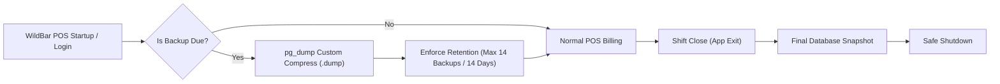

# WildBar Order Management System (OMS)
## Executive Insights, Analytics & Production-Grade Thermal Printing Guide

---

## 1. System Architecture Overview

The WildBar Order Management System is an enterprise multi-outlet point-of-sale (POS) and operations platform. It features role-based access control (Admin, Manager, Cashier, Kitchen), multi-tenant outlet scoping, real-time Kitchen Display System (KDS), and a decoupled client-side thermal printing engine.

```
+-----------------------------------------------------------------------------------+
|                           AWS CLOUD INFRASTRUCTURE                               |
|                                                                                   |
|   +-----------------------+                    +------------------------------+   |
|   |  AWS RDS PostgreSQL   | <--(Private VPC)-- |  Spring Boot Backend API     |   |
|   |  (Multi-tenant DB)    |      < 1ms Latency |  (HikariCP: 15-20 conn pool) |   |
|   +-----------------------+                    +------------------------------+   |
+---------------------------------------------------------------^-------------------+
                                                                | HTTPS (JWT REST)
+---------------------------------------------------------------v-------------------+
|                        OUTLET CASHIER TERMINALS (1 to 25+)                        |
|                                                                                   |
|   +---------------------------------------------------------------------------+   |
|   |  Angular POS / Billing Frontend (Chrome Kiosk Mode / Electron App)        |   |
|   |  - Client-side @media print Thermal Receipt Engine                        |   |
|   |  - Dynamic GSTIN & Tax Breakdown Formatting                               |   |
|   +---------------------------------------------------------------------------+   |
|                                     | (Direct USB / LAN / Wi-Fi)                  |
|                                     v                                             |
|              +---------------------------------------------+                      |
|              |  Physical 80mm / 58mm Thermal Receipt POS   |                      |
|              |  (Epson, TVS, Citizen, Star, Xprinter)      |                      |
|              +---------------------------------------------+                      |
+-----------------------------------------------------------------------------------+
```

---

## 2. Dashboard & Executive Insights Engine

### 2.1 Core Metrics & Accounting Rules
The Executive Dashboard calculates real-time operational KPIs with strict financial accounting standards:

- **Gross Revenue**: Calculated **strictly** from completed bills where `status IN ('BILLED', 'PAID')`. Pre-order states (`SOFT_ORDER`, `CONFIRMED`, `PREPARING`, `READY`, `SERVED`) and `CANCELLED` orders are excluded from revenue to prevent financial leakage.
- **Order Volume**: Count of completed transactions within the selected date window.
- **Average Ticket Size (AOV)**: Gross Revenue divided by Total Completed Orders.
- **Active Table Occupancy**: Live ratio of occupied tables vs. total registered tables.

### 2.2 Multi-Outlet Scoping
- **Super Admin**: Can toggle between **Consolidated View** (aggregating revenue, transaction volume, and popular dishes across all 25+ outlets) or filter into any specific branch.
- **Outlet Staff (Managers / Cashiers)**: Automatically locked to their assigned `outlet_id`. The multi-tenant backend enforces SQL row-level tenant filtering (`WHERE outlet_id = :currentOutletId`).

### 2.3 Visual Performance Analytics
1. **Revenue Trends (Time Series)**: Daily and hourly revenue trends plotted against order volume.
2. **Sales by Category & Top Selling Items**: Item-level velocity tracking ranking dishes by quantity sold and total revenue contribution.
3. **Payment Method Distribution**: Visual breakdown across **Cash**, **Credit/Debit Card**, and **UPI / Digital Wallets**.
4. **Table Turnaround Time**: Performance metrics measuring order placement to final bill settlement.

### 2.4 Executive JasperReports Report Builder
Located in the Outlet Management view, the Report Builder allows exporting pixel-perfect, printable PDF reports and multi-sheet Excel spreadsheets using the JasperReports engine:

| Report Type | Scope | Output Formats | Purpose |
| :--- | :--- | :--- | :--- |
| **Daily Multi-Outlet Breakdown** | Date Range / All Outlets | Adobe PDF, Excel (.xlsx) | Grouped day-by-day and branch-by-branch with daily sub-totals and grand totals. |
| **Monthly Consolidated** | Date Range / All Outlets | Adobe PDF, Excel (.xlsx) | High-level executive performance summary across branches month-by-month. |
| **Detailed Orders Audit Log** | Custom Dates / Filtered Branch | Adobe PDF, Excel (.xlsx) | Complete order-by-order audit log including order numbers, tables, payment types, and settled-by staff. |
| **Sales Summary** | Custom Dates / Filtered Branch | Adobe PDF, Excel (.xlsx) | Condensed transaction volume, total collected revenue, and average ticket size. |

---

## 3. Production-Grade Thermal Receipt Printing

WildBar uses a **decoupled, client-side thermal printing architecture**. The cloud backend processes data and returns statutory tax structures; the client machine running the POS triggers the local hardware printer via the OS print spooler.

### 3.1 Supported Hardware
- **Standard 80mm POS Printers**: Epson TM-T88 Series, TVS RP3200 Star, Citizen CT-S310, Bixolon SRP-350, Xprinter XP-N160II / XP-Q200.
- **Compact 58mm POS Printers**: TVS RP58, NGX POS, Bluetooth 58mm mobile thermal printers.
- **Interface Support**: USB Type-B/A, Ethernet/LAN (RJ-45), Wi-Fi, and Bluetooth.

---

### 3.2 Operating System Driver Setup (Windows 10 / 11)

To ensure razor-sharp text, proper line cutting, and zero page waste:

1. Connect the printer via USB or assign it a static IP on your restaurant LAN.
2. Install the manufacturer's **ESC/POS Virtual Port or Windows Driver** (e.g., *Epson Advanced Printer Driver (APD)* or *TVS POS Driver*).
3. Open **Windows Settings $\rightarrow$ Bluetooth & Devices $\rightarrow$ Printers & Scanners**.
4. Select your thermal printer $\rightarrow$ click **Set as default**.
5. Click **Printing Preferences**:
   - **Paper Size**: Select `Roll Paper 80 x 297 mm` (or `58 x 297 mm`).
   - **Paper Cut**: Set to **End of Page $\rightarrow$ Cut** (or **End of Document $\rightarrow$ Cut**).
   - **Cash Drawer**: Set **Open Cash Drawer $\rightarrow$ Before Printing** (pin 2/5 kick).
   - **Margins**: Set Top/Bottom/Left/Right margins to `0 mm` or `None`.

---

### 3.3 Silent Kiosk Printing (Chrome / Edge Browser)

By default, web browsers display a Print Preview modal where the user must click "Print". In high-speed retail and restaurant counters, cashiers need **1-click silent auto-printing** where paper prints and cuts instantly in $< 0.3$ seconds.

#### How to Enable Kiosk Printing:
1. Locate your **Google Chrome** or **Microsoft Edge** shortcut on the Windows desktop.
2. Right-click the shortcut $\rightarrow$ select **Properties**.
3. In the **Shortcut** tab, find the **Target** input box.
4. Add `--kiosk-printing` to the end of the line (outside the quotation marks):

```cmd
"C:\Program Files\Google\Chrome\Application\chrome.exe" --kiosk-printing https://pos.wildbar.internal
```

*(Optional: Use `--kiosk` along with `--kiosk-printing` to lock the cashier terminal into full-screen POS mode without address bars).*

5. Click **Apply** $\rightarrow$ **OK**.
6. Launch Chrome using this shortcut. 

**Result**: When the cashier clicks "Collect & Send to Kitchen" in Quick Pay or "Generate Bill", Chrome bypasses the print dialog completely, cuts the receipt, and returns focus to the POS screen immediately.

---

### 3.4 Electron Desktop App Native Printing

If packaging WildBar into an Electron desktop container, silent printing can be handled directly via Electron's native WebContents API:

```javascript
// In Electron Main Process (main.js / background.js)
const { ipcMain } = require('electron');

ipcMain.on('print-receipt', (event, printerName) => {
  const win = event.sender.getOwnerBrowserWindow();
  win.webContents.print({
    silent: true,
    printBackground: true,
    deviceName: printerName || '', // Leave empty to use system default
    margins: {
      marginType: 'none'
    }
  }, (success, failureReason) => {
    if (!success) console.error('Print failed:', failureReason);
  });
});
```

---

## 4. System Settings Configuration

Navigate to **System Settings** in the WildBar dashboard to configure billing defaults:

| Setting Field | Production Recommendation | Impact |
| :--- | :--- | :--- |
| **Restaurant Name** | Official legal trading name (e.g., `WildBar & Kitchen`) | Centered prominently at the top and bottom of all customer bills. |
| **GST Number (GSTIN)** | 15-digit statutory GSTIN (e.g., `29AAAAA0000A1Z5`) | Printed under the title and sub-total for statutory tax compliance. |
| **Tax Name** | `GST` (or `VAT` / `Service Tax`) | Label used on receipt tax calculation rows. |
| **Tax Rate (%)** | Set rate (e.g., `5%` for restaurants) | Multiplier used during billing. |
| **Default Global Discount (%)** | Standard outlet discount (e.g., `0%` or `10%`) | Pre-fills the discount calculation during Quick Pay checkout. |
| **Thermal Printing (Auto-Print)** | **Enabled (`true`)** | Automatically shoots print job to the printer immediately on bill settlement. |
| **Paper Size** | `80mm` (Standard) or `58mm` (Compact) | Sets CSS print layout constraints. |

---

## 5. End-to-End Receipt Printing Workflows

### Flow 1: POS Terminal "Quick Pay & Settle"
1. Cashier adds items to cart or opens an active table tab.
2. Cashier clicks **"Quick Pay"**.
3. Selects payment method (**Cash**, **Card**, or **UPI**) and tenders cash.
4. Clicks **"Collect & Send to Kitchen"**.
5. **Backend**:
   - Generates final bill with GST calculations and discounts.
   - Records payment and links the settling staff identity.
   - Advances order status to `BILLED` / `PAID` and routes order to Kitchen Display.
6. **Frontend**:
   - Receives settled order payload.
   - Mounts the `#thermal-receipt` print view into the DOM.
   - If `thermalPrintingEnabled: true`: Automatically invokes `window.print()` within 350ms.
   - Under Chrome Kiosk mode, receipt prints and cuts with zero user intervention.

### Flow 2: Orders & Billing "Print Bill Only (Pay Later)"
1. Customer requests a check before paying.
2. Cashier selects the active order and clicks **"Print Bill Only (Pay Later)"**.
3. **Backend**: Locks items, computes taxes/subtotal, marks status as `BILLED`.
4. **Frontend**: Launches the Receipt Preview modal and shoots the thermal print job to the physical printer.
5. Once the customer presents payment, cashier settles via Cash, Card, or UPI.

---

## 6. Thermal Receipt Physical Layout Specification

The `#thermal-receipt` container in `orders-billing` and `pos-terminal` follows the standard commercial POS layout:

```text
================================================
                    WILDBAR
            Order Management System
             GSTIN: 29AAAAA0000A1Z5
             Order #WB-IND-1042
             DINE_IN • Table 04
------------------------------------------------
2x Grilled Chicken Tikka                ₹560.00
1x Virgin Mojito                        ₹180.00
1x Garlic Naan                           ₹60.00
------------------------------------------------
Subtotal:                               ₹800.00
GST (5%):                                ₹40.00
Discount:                                -₹50.00
------------------------------------------------
GRAND TOTAL:                            ₹790.00
------------------------------------------------
Settled By: Murali (Cashier)
------------------------------------------------
             GSTIN: 29AAAAA0000A1Z5
        Thank you for dining with WildBar!
              Visit us again soon.
================================================
[PAPER CUT]
```

---

## 7. Production Troubleshooting & Checklist

| Issue | Root Cause | Solution |
| :--- | :--- | :--- |
| **Browser asks "Save as PDF" instead of printing** | Chrome printer destination is set to PDF. | Open Chrome print dialog once, choose your USB/LAN Thermal Printer, and print. Chrome will store it as default. |
| **Print Preview popup halts cashier workflow** | Standard Chrome profile without kiosk mode. | Launch Chrome with the `--kiosk-printing` flag on the cashier shortcut. |
| **Margins cut off text on receipt edges** | Driver margins set to Default (0.25in). | Set printer driver margins to `None` / `0mm` in Windows Printing Preferences. |
| **Paper cuts before printing completes** | Windows spooler length set to standard A4/Letter. | In printer properties, select Continuous Roll format (e.g., `80mm x 297mm` or `80mm x 3276mm`). |
| **Cash Drawer does not kick open** | Driver drawer kick setting disabled. | Enable "Open Cash Drawer Before Printing" in the driver's Device Settings tab. |
| **GSTIN not showing on receipt** | Blank field in System Settings. | Enter your 15-digit GSTIN in **System Settings $\rightarrow$ Financial & Billing Defaults** and click Save. |

---

## 8. Real-Time Kitchen Display (SSE) & In-Memory Caching Architecture

### 8.1 Real-Time Server-Sent Events (SSE) for Kitchen Displays
To support 25+ concurrent branches and eliminate the high database load of short-interval HTTP polling, WildBar utilizes **Server-Sent Events (SSE)** via `SseEmitter`:

1. **Zero External Infrastructure**: SSE operates natively over standard HTTP persistent connections. No Redis, RabbitMQ, or third-party message brokers are required.
2. **Targeted Outlet Scoping**:
   - Connections to `GET /api/v1/orders/kitchen/stream?token=<jwt>&outletId=<id>` are segmented by `outletId`.
   - Cashiers, kitchen staff, and customer QR orders only broadcast events to that specific outlet's kitchen screens.
   - Super-Admin displays connect with `outletId=all` to receive multi-branch consolidated events.
3. **Sub-20ms Event Delivery**: When a ticket is placed, items appended, or order state changed, the event (`ORDER_UPDATE` or `QUEUE_CLEARED`) is pushed immediately to kitchen screens.
4. **AWS ALB & Proxy Keepalive (25s Heartbeat)**: A background heartbeat (`PING`) runs every 25 seconds to prevent AWS Application Load Balancers (ALBs) or Nginx proxies from terminating idle connections (which default to 60s idle timeouts), while automatically pruning disconnected browser tabs.
5. **Fallback Safety Net**: The frontend KDS maintains an unobtrusive 60-second fallback sync to ensure absolute data consistency even across spotty kitchen Wi-Fi connections.

### 8.2 Production In-Memory Caching (Zero Stale Data)
Read-heavy GET endpoints are accelerated with Spring Boot In-Memory Caching (`@EnableCaching`):
- **Menu Categories & Items**: `@Cacheable(value = "menuCategories")` and `@Cacheable(value = "menuItems")` cache active dishes and category lists in JVM heap memory.
- **System Configuration**: `@Cacheable(value = "systemConfig", key = "'global'")` caches tax rates, store names, and GST numbers for zero-latency POS lookups.
- **Instant Eviction Guarantee**: All mutating operations (`createItem`, `updateItem`, `deleteItem`, `createCategory`, `updateCategory`, `deleteCategory`, `updateConfig`) feature `@CacheEvict(allEntries = true)`. Any price modification or menu change immediately purges the cache, guaranteeing **zero stale data** across all terminals.

---

## 9. Deployment Models: AWS EC2 Cloud vs. Standalone Desktop POS

WildBar supports two production deployment models depending on client needs:

### Option A: Cloud Multi-Outlet Deployment (AWS EC2)
- **Use Case:** Multi-branch restaurant chains (up to 25+ outlets) requiring centralized live analytics, KDS screens across rooms, and Customer Mobile QR Ordering.
- **Deployment Script:** Run `./deploy-ec2.sh` on Ubuntu / Amazon Linux 2023. Deploys Spring Boot, PostgreSQL, and Nginx SSL gateway in Docker with one command.
- **Thermal Printing:** Cashier computers run the **Electron Desktop POS App** (`electron-pos/`), which connects to the EC2 API for data and prints directly over the store's local Wi-Fi to 80mm ESC/POS printers.

### Option B: Standalone Offline Desktop POS (Local JAR & DB)
- **Use Case:** Single-outlet restaurants that do not require cloud hosting, KDS, or QR code ordering.
- **How it Works:** 
  1. Drop your Spring Boot JAR (any name, e.g. `order-management.jar` or `app.jar`) into `electron-pos/backend-jar/`.
  2. In `electron-pos/config.json`, set `"mode": "standalone"` (runs on default port **8089**).
  3. Start the app with `npm start` (or package into `.exe`).
  4. Electron automatically launches the local Java backend in the background, waits for the database/API to become healthy, loads the POS interface, and terminates the background Java process when the app is closed.
- **See Full Documentation:** [`electron-pos/README.md`](file:///d:/Projects/Commercial%20Projects/WildBar/Order%20Management/electron-pos/README.md).

---

## 10. Packaging the Electron Desktop Application (`.exe`)

The desktop terminal in `electron-pos/` includes `electron-builder` and a custom multi-resolution **Billing & POS Terminal icon** (`assets/icon.ico`).

### Quick Packaging Commands:
```powershell
cd electron-pos

# 1. Package single-file portable executable (Recommended):
npm run dist:portable
# Output: electron-pos/release/WildBar POS 1.0.0.exe

# 2. Package Windows NSIS installer with desktop shortcut:
npm run dist:installer
# Output: electron-pos/release/WildBar POS Setup 1.0.0.exe

# 3. Fast unpacked directory build (~10 seconds for testing):
npm run pack
# Output: electron-pos/release/win-unpacked/WildBar POS.exe
```

For complete documentation, see [`electron-pos/README.md`](file:///d:/Projects/Commercial%20Projects/WildBar/Order%20Management/electron-pos/README.md).

---

## 11. PostgreSQL Database Auto-Creation & Backup Management

WildBar POS eliminates the need to use **pgAdmin** for database initialization and provides a production-grade automated backup and restore suite for both Standalone Windows POS and Ubuntu Cloud deployments.

### 11.1 Automated Database Creation (Zero pgAdmin Setup)
- The backend automatically checks if the target database (`order_management`) exists via [`DatabaseAutoCreationListener`](backend/order-management/src/main/java/com/orders/order_management/core/config/DatabaseAutoCreationListener.java).
- If missing on a fresh installation, it connects to PostgreSQL's default maintenance database (`postgres`) and auto-creates `order_management` before Flyway migrations run.
- Zero manual database setup in pgAdmin is required.

### 11.2 The 4 Production Backup Triggers
1. **On Cashier Login**: Automatically checks if > 12 hours elapsed (e.g. terminals left running overnight) and takes a background backup upon cashier authentication.
2. **On Shift Exit**: Electron intercepts terminal close ($X$) and creates a final snapshot of today's bills before shutting down.
3. **1-Click On-Demand**: Run [`scripts/backup/backup-now.bat`](scripts/backup/backup-now.bat) for instant pre-upgrade or end-of-day safety.
4. **Cloud 2:00 AM Cron**: Ubuntu EC2 instances run nightly automated backups via Docker-aware scripts.

### 11.3 Credential Protection (Windows DPAPI)
- Database passwords in [`backup-config.json`](backup-config.json) are automatically encrypted using **Windows DPAPI** (`enc:dpapi:...`).
- The plaintext password is wiped from disk on first run.
- Encryption keys are tied to the local machine's hardware TPM and user account, meaning credentials cannot be stolen or decrypted if the config file is copied to another outlet computer.



### 11.4 1-Click Disaster Recovery Restore
- Double-click [`scripts/backup/restore-now.bat`](scripts/backup/restore-now.bat).
- The script automatically severs active connections (`pg_terminate_backend`), drops and re-creates the database (`DROP DATABASE WITH (FORCE)`), and restores all tables, constraints, and data from the latest `.dump` file.

For detailed documentation, flow diagrams, and cloud setup, see [`scripts/backup/README.md`](scripts/backup/README.md).


