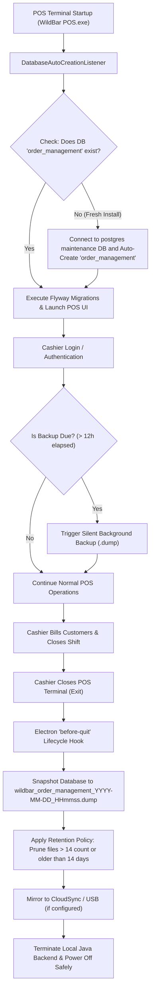
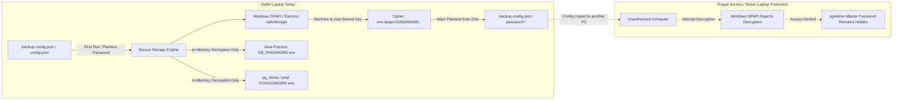
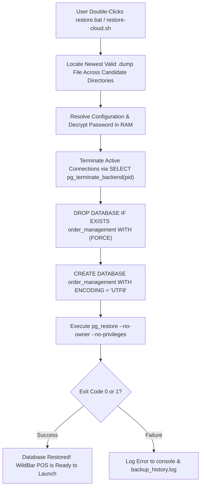

# WildBar POS - Production Database Backup & Disaster Recovery Suite

A production-grade, automated database backup and disaster recovery suite designed for two deployment topologies:
1. **Standalone Offline Desktop POS (Windows 10 / 11)**: Tailored for retail counters where cashiers power off terminals overnight or leave the terminal running 24/7 across multi-shift operations.
2. **Cloud Multi-Outlet Instances (Ubuntu 22.04 / 24.04 / AWS EC2)**: Docker-aware, hands-free cron automation for multi-branch centralized servers.

---

## Table of Contents
- [1. How It Works: The 4 Backup Triggers](#1-how-it-works-the-4-backup-triggers)
- [2. Architectural Flow Diagrams](#2-architectural-flow-diagrams)
  - [A. End-to-End Automated POS Lifecycle](#a-end-to-end-automated-pos-lifecycle)
  - [B. Multi-Outlet Credential Protection (Windows DPAPI & safeStorage)](#b-multi-outlet-credential-protection-windows-dpapi--safestorage)
  - [C. 1-Click Disaster Recovery Restore Flow](#c-1-click-disaster-recovery-restore-flow)
- [3. Project Directory Structure](#3-project-directory-structure)
- [4. Unified Configuration: `backup-config.json`](#4-unified-configuration-backup-configjson)
- [5. Security & Machine Isolation Guarantee](#5-security--machine-isolation-guarantee)
- [6. Zero-Permission Failure Guarantee](#6-zero-permission-failure-guarantee)
- [7. Standalone Windows POS Guide](#7-standalone-windows-pos-guide)
- [8. Cloud Ubuntu / AWS EC2 Deployment Guide](#8-cloud-ubuntu--aws-ec2-deployment-guide)
- [9. Disaster Recovery Runbook](#9-disaster-recovery-runbook)

---

## 1. How It Works: The 4 Backup Triggers

A POS terminal cannot rely solely on a fixed 2:00 AM nightly schedule because **cashiers power off their computers when closing the shop at night**. Conversely, in busy outlets, cashiers leave the app open for days without closing it.

WildBar POS solves this with **4 complementary triggers**:

| Trigger | Environment | When it Runs | Purpose |
|---|---|---|---|
| **1. On Cashier Login** | Standalone Desktop | Cashier authenticates (morning shift or after JWT expiry). | **Overnight Safe**: If the app stayed open all night, the morning login detects > 12h elapsed and takes a background snapshot immediately (`~300ms`). |
| **2. On Shift Exit** | Standalone Desktop | Cashier closes the POS window ($X$) at end of shift. | **Shutdown Safe**: Electron intercepts `before-quit`, creates a final `.dump` of today's sales, and safely stops the backend. |
| **3. 1-Click On-Demand** | Windows / Linux | User double-clicks `backup.bat` or runs `backup-cloud.sh`. | **Instant Snapshot**: For pre-upgrade or end-of-day safety. |
| **4. Automated Nightly Cron** | Ubuntu Cloud | Runs at 2:00 AM server time via `/etc/cron.d/wildbar-backup`. | **24/7 Cloud Automation**: Hands-free daily backup for AWS EC2 instances. |

---

## 2. Architectural Flow Diagrams

### A. End-to-End Automated POS Lifecycle



---

### B. Multi-Outlet Credential Protection (Windows DPAPI & safeStorage)

When distributing the standalone POS application across franchisee laptops, database credentials must never be leaked in plaintext config files:



---

### C. 1-Click Disaster Recovery Restore Flow



---

## 3. Project Directory Structure

```
WildBar Order Management/
├── backup-config.json                       # Master root backup & retention configuration
├── scripts/
│   └── backup/
│       ├── backup-config.json               # Dedicated backup configuration
│       ├── backup-now.bat                   # Root 1-click backup shortcut
│       ├── restore-now.bat                  # Root 1-click restore shortcut
│       ├── README.md                        # This comprehensive guide
│       ├── windows/
│       │   ├── backup.bat                   # Interactive Windows backup launcher
│       │   ├── backup.ps1                   # Production PowerShell backup engine (DPAPI enabled)
│       │   ├── restore.bat                  # Interactive Windows restore launcher
│       │   ├── restore.ps1                  # Production PowerShell restore engine (Clean drop & re-create)
│       │   └── setup-startup-task.ps1         # Auto-registers Windows Logon/Startup Scheduled Task
│       └── cloud/
│           ├── backup-cloud.sh              # Docker-aware PostgreSQL backup script for Ubuntu EC2
│           ├── restore-cloud.sh             # Cloud database restore script
│           └── setup-cron.sh                # Automates daily 2:00 AM cron schedule
└── electron-pos/
    ├── backup-config.json                   # Packaged standalone configuration
    ├── backup-manager.js                    # Node.js automated backup engine (on-login, on-exit)
    ├── secure-storage.js                    # Windows DPAPI / Electron safeStorage cryptographic bridge
    └── backend-runner.js                    # Spawns Java backend with in-memory decrypted credentials
```

---

## 4. Unified Configuration: `backup-config.json`

All settings for both Windows and Linux are managed centrally in [`backup-config.json`](../../backup-config.json):

```json
{
  "database": {
    "host": "localhost",
    "port": 5432,
    "name": "order_management",
    "username": "postgres",
    "password": "",
    "encryptedPassword": "enc:dpapi:01000000d08c9ddf0115d1118c7a00c04fc297eb01000000b3c954fb28b4f242..."
  },
  "standalone": {
    "enabled": true,
    "backupDirectory": "D:\\WildBar_Backups",
    "fallbackDirectory": "%USERPROFILE%\\WildBar_Backups",
    "backupOnExit": true,
    "backupOnLogin": true,
    "backupOnLoginIntervalHours": 12,
    "cloudSyncDirectory": ""
  },
  "cloud": {
    "dockerContainer": "om_postgres",
    "backupDirectory": "/var/backups/wildbar",
    "cronSchedule": "0 2 * * *",
    "s3Bucket": ""
  },
  "retention": {
    "maxBackupsToKeep": 14,
    "retentionDays": 14,
    "deleteOldestWhenLimitReached": true
  }
}
```

### Detailed Field Explanation

| Section | Field | Default | Description |
|---|---|---|---|
| **`database`** | `host` | `localhost` | PostgreSQL host address (`127.0.0.1` or Docker container name). |
| | `port` | `5432` | PostgreSQL listening port. |
| | `name` | `order_management` | Database name to snapshot and restore. |
| | `username` | `postgres` | PostgreSQL administrative / application user. |
| | `password` | `""` | Plaintext password. **Automatically wiped from disk** on first execution once encrypted! |
| | `encryptedPassword` | `enc:dpapi:...` | Hardware-bound DPAPI encrypted password. Never reveals plaintext password. |
| **`standalone`** | `enabled` | `true` | Enables or disables automated desktop backups. |
| | `backupDirectory` | `D:\WildBar_Backups` | Primary local backup folder. |
| | `fallbackDirectory` | `%USERPROFILE%\WildBar_Backups` | **Permission Safety Fallback**: Used automatically if the primary drive does not exist or lacks write permissions. |
| | `backupOnExit` | `true` | Automatically snapshots the database when cashier closes the POS terminal. |
| | `backupOnLogin` | `true` | Automatically snapshots the database when cashier logs in (if interval elapsed). |
| | `backupOnLoginIntervalHours` | `12` | Minimum hours between automatic on-login backups to avoid redundant backups during quick cashier switches. |
| | `cloudSyncDirectory` | `""` | Optional secondary mirror folder (e.g. OneDrive, Google Drive, or external USB drive). |
| **`cloud`** | `dockerContainer` | `om_postgres` | Name of the PostgreSQL Docker container on Ubuntu EC2. |
| | `backupDirectory` | `/var/backups/wildbar` | Primary backup directory on the Ubuntu host. |
| | `cronSchedule` | `0 2 * * *` | Standard 5-field cron expression (2:00 AM daily). |
| | `s3Bucket` | `""` | Optional AWS S3 bucket name to mirror backups to the cloud. |
| **`retention`**| `maxBackupsToKeep` | `14` | Keeps the latest $N$ backups. Excess older dumps are pruned automatically. |
| | `retentionDays` | `14` | Deletes any backup older than $N$ days to protect disk storage. |

---

## 5. Security & Machine Isolation Guarantee

### The Multi-Outlet Security Challenge:
If you ship configuration files to multiple outlet laptops with database passwords in plaintext, cashiers or franchisees could open `config.json`, extract the master PostgreSQL password, and manipulate the database directly via pgAdmin or script new databases.

### The WildBar Solution:
1. **Windows Data Protection API (DPAPI)**:
   - When the application or backup script runs for the first time, it encrypts the database password using the Windows Cryptographic DPAPI subsystem (`ConvertFrom-SecureString` in PowerShell / `safeStorage` in Electron).
   - The encryption key is tied to the **local Windows user profile and machine hardware TPM/LSA**.
   - The script immediately writes the `enc:dpapi:...` cipher to `backup-config.json` and **wipes the plaintext password from disk** (`"password": ""`).
2. **Machine Isolation (Anti-Theft)**:
   - If an outlet user copies `backup-config.json` to a personal USB drive or another laptop, Windows **refuses to decrypt the ciphertext** on the foreign machine.
3. **In-Memory Credential Injection**:
   - The Electron desktop app and PowerShell scripts decrypt the password in-memory only when invoking `pg_dump.exe` or launching the Spring Boot JAR, passing `DB_PASSWORD` or `PGPASSWORD` as ephemeral environment variables that are never stored on disk.
4. **First-Time Setup Prompt**:
   - For brand new outlet installations where the password is intentionally omitted from the distributed package, the backup script prompts the technician once:
     ```
     Initial Security Setup: No database password configured.
     Please enter the PostgreSQL password (will be encrypted with Windows DPAPI and stored securely):
     ```
     Once entered, it encrypts the password into `backup-config.json` and never asks again.

---

## 6. Zero-Permission Failure Guarantee

A common failure in retail POS deployments is **Access Denied / Permission Denied** (e.g. Cashier PC has no `D:` drive, or the user is not an Administrator).

### How WildBar POS Guarantees Zero Permission Failures:
1. **Windows Auto-Probe**:
   - The backup engine tests the configured `backupDirectory` by writing a probe file `.wb-write-test`.
   - If `D:\` is missing or access is denied, it automatically switches to `%USERPROFILE%\WildBar_Backups` (e.g. `C:\Users\<Cashier>\WildBar_Backups`), which is **always 100% writable by standard Windows users** without Admin rights.
   - If that fails, it falls back to `%APPDATA%\WildBar POS\backups` and finally `os.tmpdir()`.
2. **Ubuntu Linux Auto-Probe**:
   - If running as non-root and `/var/backups/wildbar` is root-only, the script automatically falls back to `$HOME/wildbar_backups` or `./backups`.

---

## 7. Standalone Windows POS Guide

### A. How Backups Run Automatically:
- **Morning / Shift Login**: When the cashier logs into the POS, Electron monitors authentication. If more than 12 hours have passed since the last backup, an automated backup runs silently in the background (`~300ms`).
- **Shift Close (Exit)**: When the cashier clicks Close ($X$), Electron creates a final snapshot of all today's bills before terminating the local backend.
- **Audit History**: Every backup appends a line to `backup_history.log` in your backup folder.

### B. Manual 1-Click Backup:
Double-click [`windows/backup.bat`](./windows/backup.bat) (or [`backup-now.bat`](./backup-now.bat)).

### C. 1-Click Database Restore:
If a computer crashes or database needs to be restored from backup:
1. Double-click [`windows/restore.bat`](./windows/restore.bat) (or [`restore-now.bat`](./restore-now.bat)).
2. Type `Y` to confirm.
3. The restore script automatically:
   - Selects the newest `.dump` file.
   - Closes active connections using `SELECT pg_terminate_backend(pid)...`.
   - Re-creates a clean database using `DROP DATABASE IF EXISTS "order_management" WITH (FORCE)`.
   - Restores all tables, constraints, indexes, and sales records via `pg_restore.exe`.

---

## 8. Cloud Ubuntu / AWS EC2 Deployment Guide

### A. Directory Structure:
```
scripts/backup/cloud/
├── backup-cloud.sh      # Core backup script (Docker & native PostgreSQL aware)
├── restore-cloud.sh     # Clean restore script
└── setup-cron.sh        # Installs automated cron job
```

### B. Installation on Ubuntu EC2:
1. Make all scripts executable:
   ```bash
   chmod +x scripts/backup/cloud/*.sh
   ```
2. Test a manual backup:
   ```bash
   bash scripts/backup/cloud/backup-cloud.sh
   ```
   *Output:*
   ```
   [INFO] Starting Cloud Database Backup for WildBar POS
   [INFO] Using Docker container: om_postgres
   [SUCCESS] Database backup created successfully (0.04M): wildbar_order_management_2026-10-20_113748.dump
   [INFO] Applying retention policy (Keep max 14, older than 14 days)...
   ```
3. Install the daily automated cron job (runs at 2:00 AM server time):
   ```bash
   sudo bash scripts/backup/cloud/setup-cron.sh
   ```
4. Verify the registered cron job:
   ```bash
   cat /etc/cron.d/wildbar-backup
   ```

### C. Cloud Database Restore:
To restore the latest backup (or a specific file):
```bash
# Restore latest backup:
bash scripts/backup/cloud/restore-cloud.sh

# Or restore a specific backup file:
bash scripts/backup/cloud/restore-cloud.sh /var/backups/wildbar/wildbar_order_management_2026-10-20_113748.dump
```

---

## 9. Disaster Recovery Runbook

| Disaster Scenario | Immediate Recovery Action |
|---|---|
| **Hard Drive Crash / New Laptop** | 1. Install PostgreSQL 15+.<br>2. Copy the latest `.dump` file to `D:\WildBar_Backups` (or `%USERPROFILE%\WildBar_Backups`).<br>3. Double-click `restore-now.bat` (Windows) or run `bash restore-cloud.sh` (Linux). |
| **Accidental Order Deletion / Corrupt Data** | 1. Close WildBar POS.<br>2. Run `restore-now.bat` to revert to the previous shift's snapshot.<br>3. Launch WildBar POS. |
| **Cashier Terminal Setup (Fresh DB)** | Simply start the app. The Spring Boot backend automatically runs [`DatabaseAutoCreationListener`](../../backend/order-management/src/main/java/com/orders/order_management/core/config/DatabaseAutoCreationListener.java) to create the database without pgAdmin! |
| **PostgreSQL Port Busy / Blocked Connections** | `restore.bat` automatically executes `pg_terminate_backend(pid)` to sever hanging sessions before executing `DROP DATABASE WITH (FORCE)`. |
